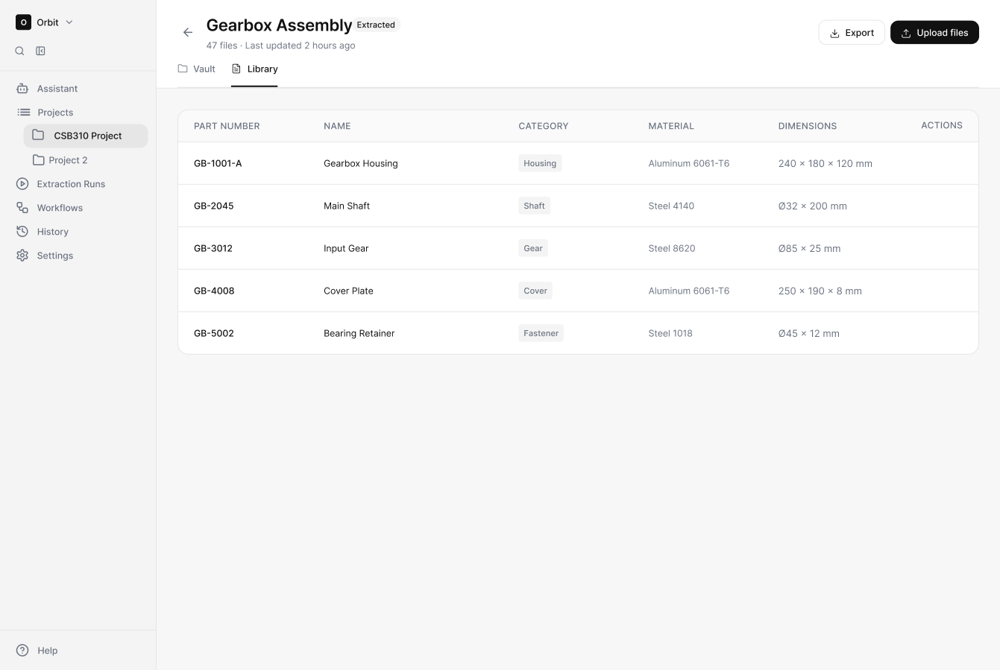
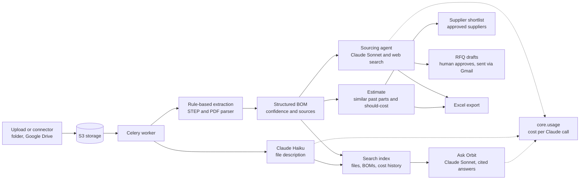

# Orbit

Orbit reads a hardware team's CAD files and drawings, lists the parts, and returns a costed bill of materials with supplier options.

## Why

At a small or mid-sized hardware company there is often no dedicated buyer. The engineer who designs a part also has to find a shop to make it, guess a fair price and chase quotes by email, and past parts, prices and decisions are scattered across files nobody can search. Orbit is a student venture project that tries to take on that work: turn the files into structured part records, estimate cost from parts the team has already bought, and help with supplier research and quote requests, with a person approving anything that leaves the building.



*The parts library for one project, shown with sample data.*

## What it does

- Takes uploads of STEP, PDF, DWG/DXF, IGES and MATLAB files (up to 100 MB), or indexes files in place from a folder or Google Drive.
- Extracts a structured BOM from STEP assemblies and PDF drawings, with a confidence score and a source for every value, and flags rows that need review.
- Writes a short plain-English description of each file with Claude Haiku and makes files, BOMs and cost history searchable.
- Answers questions about the team's own files ("Ask Orbit") with Claude Sonnet, citing the snippets it used.
- Estimates cost per BOM line from the closest past parts (inflation adjusted) plus a material and process should-cost range. This path makes no model calls.
- Optionally runs a Claude Sonnet sourcing agent per line (approved suppliers first, web search, quotes, risk flags), drafts RFQ emails the engineer approves before they are sent from Gmail, and exports the result to Excel.
- Logs the token usage and dollar cost of every Claude call so unit costs can be measured.

## How it works



Files land in S3 and a Celery worker does the slow work. Extraction is plain Python, so no CAD runtime is needed. The estimate path is deterministic; the assistant and the sourcing agent are the only parts that call Claude Sonnet. Every Claude call goes through `core.usage.tracked_create`, which records tokens and cost.

## Quick start

```bash
git clone https://github.com/stanislavli3/orbit.git
cd orbit
make setup        # venv, pip, npm, env scaffolding
# fill in backend/.env and apps/web/.env (see below)
make dev          # LocalStack + Redis + backend + worker + frontend, one command
```

Open **http://localhost:5173**. `make dev-local` skips Docker (no S3 or Redis; jobs run inline).

### Prerequisites

| Tool              | Version  |
| ----------------- | -------- |
| Python            | 3.11+    |
| Node              | 18+      |
| Docker Desktop    | latest   |
| Clerk account     | free tier, [clerk.com](https://clerk.com) |
| Anthropic API key | [console.anthropic.com](https://console.anthropic.com) |

## Stack

| Layer    | Tech                                                       |
| -------- | ---------------------------------------------------------- |
| Frontend | React 18, TypeScript, Vite, Tailwind, MUI + Radix          |
| Backend  | Django 5, Django REST Framework, Python 3.11               |
| Auth     | Clerk (Google OAuth, magic link)                           |
| Storage  | AWS S3 (LocalStack v3 in dev)                              |
| Jobs     | Celery + Redis: extraction, BOM research, library ingest   |
| AI       | Anthropic Claude: Haiku for descriptions, Sonnet for the assistant and agent |
| Database | SQLite in dev, PostgreSQL in prod                          |

## Environment

### `backend/.env`

```env
SECRET_KEY=<python -c "import secrets; print(secrets.token_hex(50))">
DEBUG=True
ALLOWED_HOSTS=127.0.0.1,localhost

CLERK_JWT_KEY=-----BEGIN PUBLIC KEY-----\nMIIB...\n-----END PUBLIC KEY-----
CLERK_ISSUER=https://your-app.clerk.accounts.dev

CORS_ALLOWED_ORIGINS=http://localhost:5173,http://localhost:5174

AWS_S3_ENDPOINT_URL=http://localhost:4566
AWS_ACCESS_KEY_ID=test
AWS_SECRET_ACCESS_KEY=test
AWS_S3_REGION_NAME=us-east-1
AWS_STORAGE_BUCKET_NAME=orbit-local

ANTHROPIC_API_KEY=sk-ant-...

CELERY_BROKER_URL=redis://localhost:6379/0
```

> Clerk: Dashboard, then API Keys, then JWT public key. Paste the full PEM on one line and escape newlines as `\n`.

### `apps/web/.env`

```env
VITE_CLERK_PUBLISHABLE_KEY=pk_test_...
VITE_API_URL=http://localhost:8000
```

## Make targets

| Command         | What it does                                              |
| --------------- | --------------------------------------------------------- |
| `make setup`    | First-time install: venv, pip, npm, env scaffolding       |
| `make dev`      | LocalStack + Redis + backend + Celery worker + frontend   |
| `make dev-local`| Backend + frontend only (no Docker or S3; jobs run inline)|
| `make worker`   | Celery worker in the foreground (needs Redis running)     |
| `make stop`     | Stop backend, worker, frontend + `docker compose down`    |
| `make restart`  | Stop, then start                                          |
| `make migrate`  | Run Django migrations                                     |
| `make eval`     | Run the evaluation harness (see [eval/README.md](eval/README.md)) |
| `make logs`     | Tail backend + worker + frontend                          |

## Walkthrough

1. Sign in. Create a project.
2. Upload a CAD file. The row spinner runs while extraction works in the background.
3. Status flips to **Extracted**. An AI summary appears under the filename; you can edit it inline.
4. Expand the row to see the raw extraction: schema, units, confidence, parser warnings.
5. Open the Estimates page to get the BOM, a cost estimate per line and a shortlist of approved suppliers.
6. Optionally run the sourcing agent. It researches suppliers, drafts RFQ emails for your approval and exports an Excel workbook.

Sample files to try are in [`samples/`](samples/).

## Repo layout

```
orbit/
├── Makefile                    # one-command dev automation
├── docker-compose.yml          # LocalStack (pinned to v3) + Redis (Celery broker)
├── render.yaml                 # hosted demo blueprint (see docs/deploy.md)
├── apps/web/                   # Vite + React frontend
├── backend/                    # Django backend
│   ├── config/                 # settings, root URLs, Celery app
│   ├── files_api/              # upload, connectors, extraction, AI description
│   │   ├── extractor.py        #   pure-Python STEP header parser
│   │   ├── ai_description.py   #   Claude Haiku
│   │   ├── embeddings.py       #   hashed TF-IDF vectors for search
│   │   └── s3_service.py       #   S3 upload / download
│   ├── bom_agent/              # structured BOM, sourcing agent, RFQ loop, Gmail, Excel export
│   ├── part_history/           # cost history, estimates, should-cost, supplier shortlist
│   ├── design_review/          # version compare, bounding-box interference checks
│   ├── assistant/              # unified search and Ask Orbit
│   ├── projects/               # project CRUD
│   ├── core/                   # job monitoring, LLM usage and cost logging
│   └── accounts/               # Clerk-backed auth
├── eval/                       # evaluation harness and results
├── samples/                    # sample STEP, MATLAB and CSV files
└── docs/                       # deploy, CI, integrations, data policy
```

## API

All endpoints require `Authorization: Bearer <Clerk JWT>`. A few of the core ones:

| Method  | Path                              | Description                |
| ------- | --------------------------------- | -------------------------- |
| `GET`   | `/api/projects/`                  | List projects              |
| `POST`  | `/api/projects/`                  | Create project             |
| `GET`   | `/api/projects/<id>/`             | Project detail             |
| `POST`  | `/api/files/upload/`              | Upload (multipart)         |
| `GET`   | `/api/files/project/<id>/`        | List files in a project    |
| `GET`   | `/api/files/<id>/result/`         | Extraction result JSON     |
| `PATCH` | `/api/files/<id>/description/`    | Update file description    |
| `POST`  | `/api/parts/quick-estimate/`      | File in, BOM + estimate + shortlist out |

Other route groups: `/api/bom/` (structured BOMs, compliance, RFQs), `/api/parts/` (cost history, estimates, suppliers), `/api/assistant/` (search, ask, chat), `/api/review/` (design review). See `backend/config/urls.py`.

## Tests

```bash
cd backend
pytest
```

CI runs the backend tests plus frontend lint, typecheck and build on every push and pull request.

## Results

Orbit has no paying users yet; it is a student project and these are engineering checks, not customer outcomes.

- **340 backend tests pass** on `main` (`pytest` in `backend/`, run 20 Nov 2026).
- **Measured AI unit costs** in [`eval/results/cogs.json`](eval/results/cogs.json): about $0.004 to ingest a file, $0.016 to answer a question and $0.20 to source one BOM line with the agent. These come from representative token counts (the agent figure from 2 runs) at Anthropic list prices, not from billed usage.
- The extraction, retrieval and agent harnesses in [`eval/`](eval/) currently run on a small, partly synthetic corpus of 13 documents. They prove the harness works; they are not claims about real customer files.

## Team and credits

Built by a three-person student team at Lehigh University (CSB 310, spring 2026, then a BIS 372 independent study, fall 2026). Contributors to this repository: [stanislavli3](https://github.com/stanislavli3), [BenjaminHoody](https://github.com/BenjaminHoody), [asf327](https://github.com/asf327) and [SophiaCXT](https://github.com/SophiaCXT).

Stanislav Li worked on product, AI engineering and unit economics, including the cost instrumentation and evaluation harness.

Landing page: [orbit-cloud-landing-84.vercel.app](https://orbit-cloud-landing-84.vercel.app/)

## License

MIT. See [LICENSE](LICENSE).
